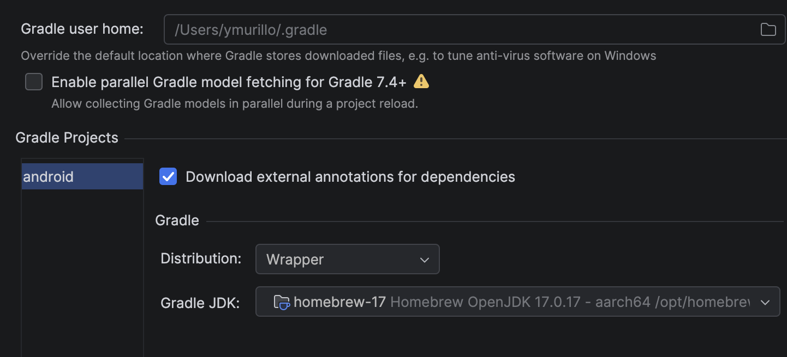
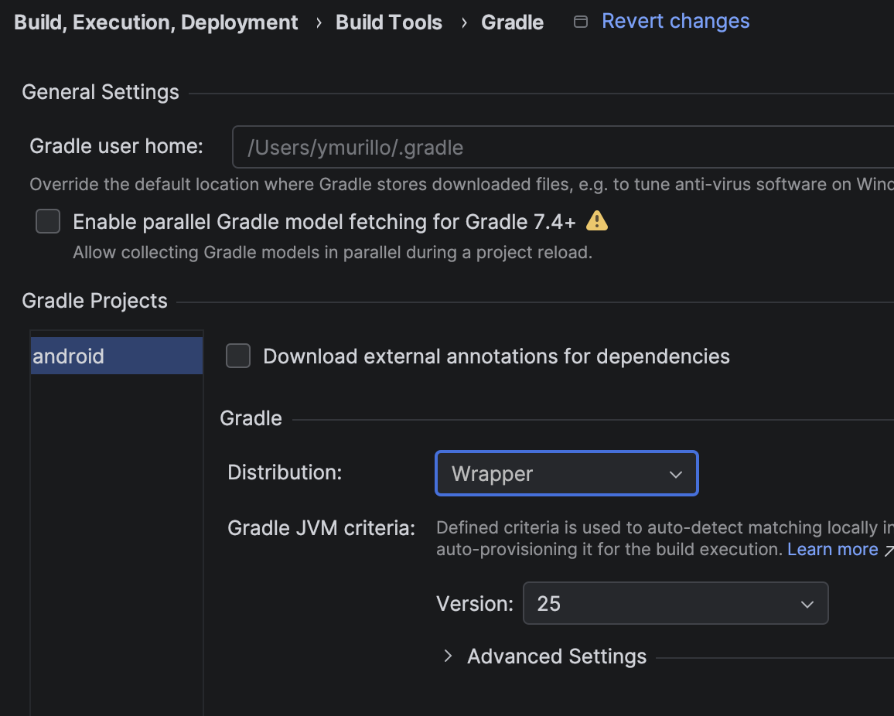
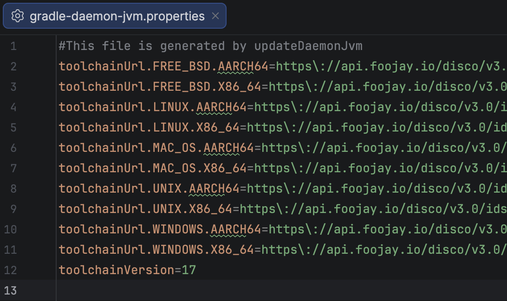

# Android: Troubleshoot Gradle and Project Sync

> Back to the [Android overview](./google.md).

Use this guide only if Android Studio cannot build or synchronize the project.

## 1. Troubleshoot a missing `build.gradle` file

If Android Studio cannot build the project because the `android/build.gradle` file does not exist, first verify whether the project uses Expo Prebuild.

For an Expo project, close Android Studio and run the following command from the project root:

```bash
npx expo prebuild --platform android
```

This command generates the native Android project when the `android` directory does not exist.

### Cleanly regenerate the Android project

If the Android project already exists but remains corrupted or cannot synchronize, it can be regenerated with:

```bash
npx expo prebuild --clean --platform android
```

Then open the generated `android` directory in Android Studio again.

> **Warning:** The `--clean` option deletes and regenerates the native project. Any manual changes made directly inside the `android` directory may be lost. Commit or back up those changes before running this command.

### Gradle installation

React Native and Expo projects normally include the Gradle Wrapper, so a global Gradle installation is usually unnecessary.

From the `android` directory, you can verify the wrapper with:

```bash
./gradlew --version
```

If the project specifically requires a global Gradle installation on macOS, it can be installed with Homebrew:

```bash
brew install gradle
```

> **Note:** Do not run `gradle init` inside an existing React Native or Expo Android project. It is intended to initialize a new Gradle project and may create files that conflict with the existing configuration.

## 2. Check the Gradle configuration in Android Studio

If the project still does not synchronize correctly:

1. Open Android Studio.
2. Open the **Settings** or **Preferences** menu.
3. Go to **Build, Execution, Deployment**.
4. Select **Build Tools → Gradle**.
5. Make sure Android Studio is using the project’s **Gradle Wrapper**.
6. Select a compatible Gradle JDK for the project.
7. Click **Sync Project with Gradle Files**.



> **Important:** Do not select an arbitrary Gradle version simply because it is considered stable. The Gradle version must be compatible with the Android Gradle Plugin used by the project, in this case, Homebrew 17.0.17 works.

> **Note:** If the Gradle configuration does not appear as shown in the previous image, Android Studio may display it in the following format:
>
> 
>
> And, if Android Studio does not allow you to update the Gradle JDK from the settings, check whether the following file exists:
>
> ```text
> android/gradle/gradle-daemon-jvm.properties
> ```
>
> 
>
> This file controls the Java/JVM version used by the Gradle daemon. Update its configuration to use **Java 17** if that is the version required by the project.
>
> > **Important:** This changes the Java version used to run Gradle, not the Gradle version itself. In our project, the required Java version is **17**.
>
> After making the change, synchronize the project again by selecting:
>
> **File → Sync Project with Gradle Files**
>
> **End of Note**
