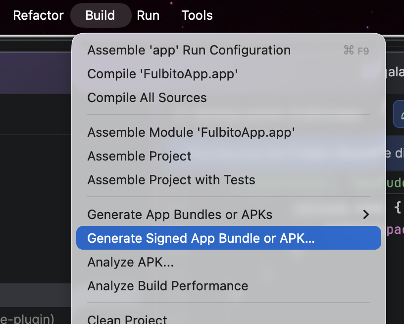
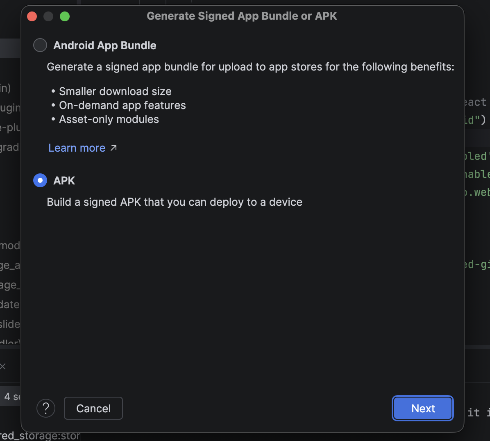
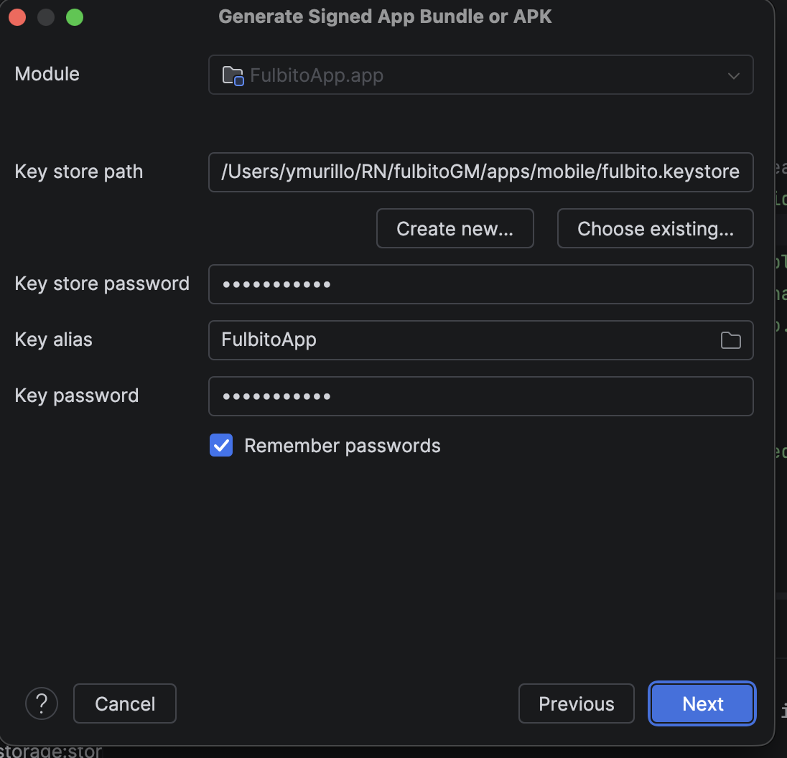
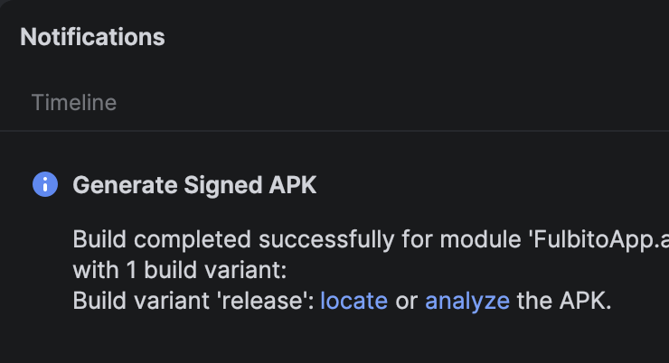

# Android: Generate a Signed Build

> Back to the [Android overview](./google.md).

## 1. Generate a signed Android build

Before opening Android Studio, regenerate the native project so it picks up the current `app.json` (`versionCode`, plugins). The `android` folder is not in git, so an old local copy would be stale:

```bash
npx expo prebuild --platform android --clean
```

Then open the `android` folder in Android Studio.

After the project synchronizes successfully, Android Studio will provide the option to generate a signed APK or Android App Bundle.

From the Android Studio menu, select:

**Build → Generate Signed Bundle / APK**



> **Note:** Other build options may generate development or unsigned artifacts. These are useful for local testing, but they are not necessarily suitable for publication on Google Play.

## 2. Select the artifact type

Android Studio will ask which type of artifact should be generated:

- **APK:** Recommended when the application must be installed or shared directly for testing.
- **Android App Bundle (`.aab`):** Recommended for publishing the application on Google Play.

For a Google Play release, select **Android App Bundle** and click **Next**.



Google Play uses the App Bundle to generate optimized APK files for different devices and configurations.

## 3. Configure the signing credentials

On the signing configuration screen, select the `.keystore` or `.jks` file provided by the project administrators.

Enter the following information:

- **Key store path:** Location of the keystore file.
- **Key store password:** Password assigned to the keystore.
- **Key alias:** Alias used when the key was created.
- **Key password:** Password assigned to the key alias.



You may enable **Remember passwords** if the computer is secure and used only by an authorized developer.

> **Security note:** Do not enable this option on a shared or public computer.

Click **Next**, select the `release` build variant, and continue with the build process.

## 4. Locate the generated file

If the build completes successfully, Android Studio will display a notification indicating that the signed APK or App Bundle was generated.



Click **Locate** in the notification to open the directory containing the generated file.

The output is commonly located in one of the following directories:

For an Android App Bundle:

```text
android/app/build/outputs/bundle/release/app-release.aab
```

For an APK:

```text
android/app/build/outputs/apk/release/app-release.apk
```

The `.aab` file can then be uploaded to the appropriate release section in Google Play Console.

Next step: [Upload the .aab to Google Play](./android-upload-to-google-play.md).
