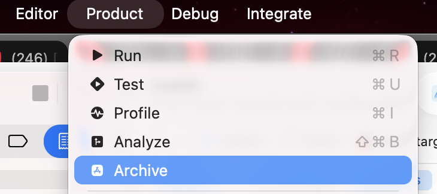
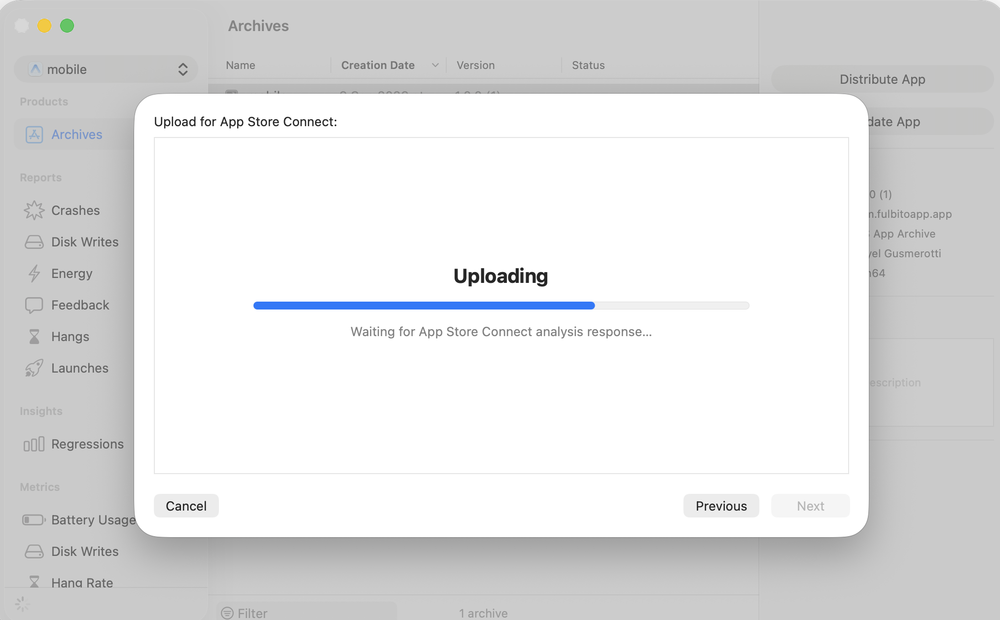
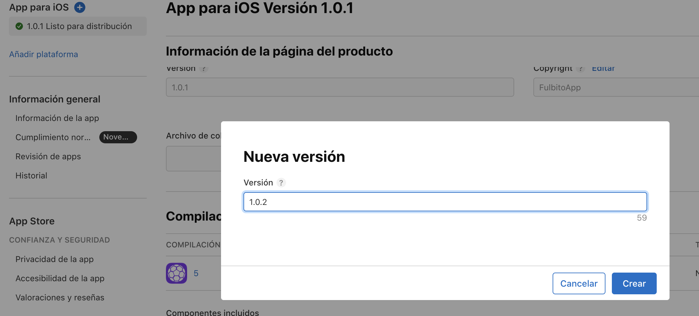
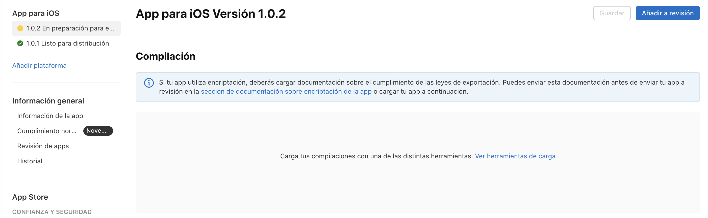

# iOS: Create an Archive and Upload to TestFlight

> Back to the [Apple overview](./apple.md).

Once the application has been properly configured and signed, an archive can be created for distribution through App Store Connect and TestFlight.

## 1. Create an Archive

In Xcode, select:

**Product → Archive**

Xcode will compile the application and create an **Archive**.

If the archive is created successfully, Xcode will open the **Organizer** window with the newly created build.

---

## 2. Distribute the Build

In the Xcode **Organizer**, select the archive you want to upload and click:

**Distribute App**

Follow the distribution wizard and select the appropriate distribution method for the project.

Xcode will validate the archive and upload the build to **App Store Connect**.

Wait for the upload and processing process to complete.

> **Note:** The upload process may take several minutes depending on the size of the application and the network connection.

---

## 3. TestFlight Availability

After the build has been successfully uploaded, Apple needs to process the build before it becomes available in **TestFlight**.

In most cases, the build may become available within approximately **15–30 minutes**, although processing times can vary.

Once processing is complete, the build can be found in:

**App Store Connect → My Apps → [Your App] → TestFlight**

From there, the build can be assigned to the appropriate **Testers** or **Test Groups**.

> **Important:** The build must finish processing successfully before it can be distributed to testers. If Apple detects an issue during processing, the build may appear with a processing or validation error that must be resolved before distribution.

---

## 4. Create the Version for Production (App Store Connect)

The build that went through TestFlight is not published yet. To send it to Apple's App Review and release it on the App Store, you first need to create a **new version** in App Store Connect.

### 4.1 Create the new version

In **App Store Connect → My Apps → [Your App] → Distribution** (the App Store tab), click the blue **+** button next to **iOS App** (top of the left sidebar).

Enter the new version number (for example `1.0.2`) and click **Create**.

> **Important:** The version number must match the `CFBundleShortVersionString` of the build you uploaded (`ios.infoPlist.CFBundleShortVersionString` in `app.json`). See [Version and build number](./ios-version-and-build-number.md).

The new version appears in the left sidebar with the status **Prepare for Submission** (yellow dot), next to the previous version (green dot, **Ready for Distribution**).

### 4.2 Select the build

Open the new version and scroll to the **Build** section. This is where you choose which of the builds uploaded to TestFlight will be sent for that version.

Select the build you want to release. Only builds that already finished processing in TestFlight are listed. If the section is empty, as in the screenshot, the build has not been selected yet or is still processing: wait for it to finish, then add it.

> **Note:** If the app uses encryption, Apple may ask for export compliance documentation before the build can be submitted.

### 4.3 Send to review

Once the build is selected and the version information is complete, click **Add for Review** (top right) and submit it to App Review.
