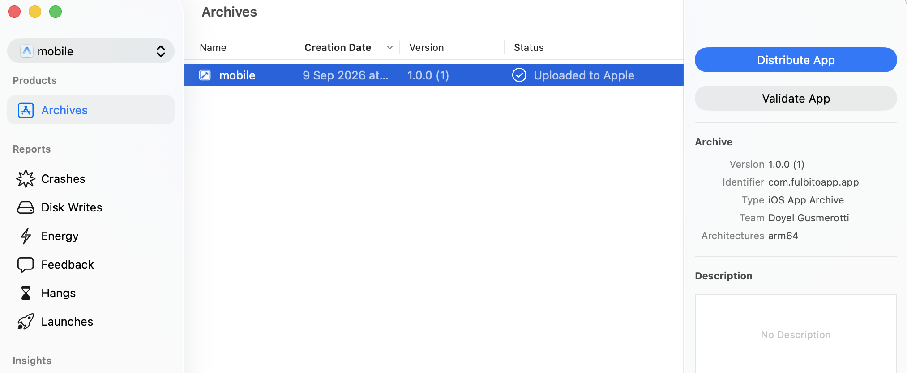
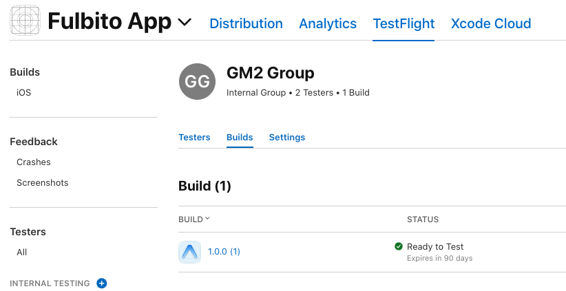

# iOS: Create an Archive and Upload to TestFlight

> Back to the [Apple overview](./apple.md).

Once the application has been properly configured and signed, an archive can be created for distribution through App Store Connect and TestFlight.

## 1. Create an Archive

In Xcode, select:

**Product → Archive**

Xcode will compile the application and create an **Archive**.

If the archive is created successfully, Xcode will open the **Organizer** window with the newly created build.

---

## 2. Distribute the Build

In the Xcode **Organizer**, select the archive you want to upload and click:

**Distribute App**

Follow the distribution wizard and select the appropriate distribution method for the project.

Xcode will validate the archive and upload the build to **App Store Connect**.

Wait for the upload and processing process to complete.

> **Note:** The upload process may take several minutes depending on the size of the application and the network connection.

---

## 3. TestFlight Availability

After the build has been successfully uploaded, Apple needs to process the build before it becomes available in **TestFlight**.

In most cases, the build may become available within approximately **15–30 minutes**, although processing times can vary.

Once processing is complete, the build can be found in:

**App Store Connect → My Apps → [Your App] → TestFlight**

From there, the build can be assigned to the appropriate **Testers** or **Test Groups**.

> **Important:** The build must finish processing successfully before it can be distributed to testers. If Apple detects an issue during processing, the build may appear with a processing or validation error that must be resolved before distribution.
