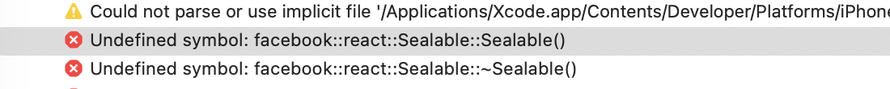

# iOS: Troubleshooting

> Back to the [Apple overview](./apple.md).

## 1. `Undefined symbol: facebook::react::Sealable::Sealable()`

When attempting to create a TestFlight archive, you may encounter an error similar to:

```text
Undefined symbol: facebook::react::Sealable::Sealable()
```



This can sometimes be caused by stale Xcode build artifacts or cached files.

### Step 1 — Remove DerivedData

Run the following command from the terminal:

```bash
rm -rf ~/Library/Developer/Xcode/DerivedData
```

### Step 2 — Clean the Build Folder

In Xcode, select:

**Product → Clean Build Folder**

### Step 3 — Create the Archive Again

After cleaning the project, try creating the archive again:

**Product → Archive**

> **Note:** Clearing `DerivedData` and performing a clean build can resolve issues caused by stale or incompatible build artifacts.
