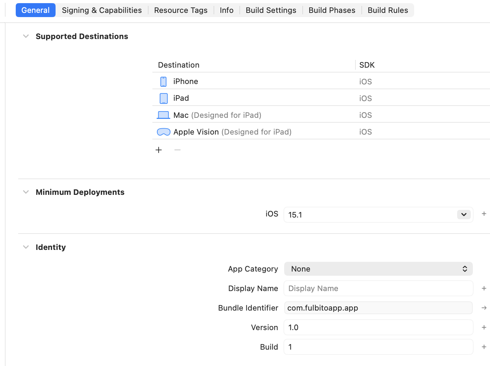

# iOS: Application Version and Build Number

> Back to the [Apple overview](./apple.md).

## Where to change them: `app.json` (Xcode is optional)

**Configuring the version and build number in Xcode is optional.** Both values are taken from `apps/mobile/app.json` every time the native project is generated, so that is the place to change them:

```json
"version": "1.0.1",
"ios": {
  "buildNumber": "5",
  "infoPlist": {
    "CFBundleShortVersionString": "1.0.1"
  }
}
```

| Value                               | `app.json` key                                          |
| ----------------------------------- | ------------------------------------------------------- |
| Version (shown to users)            | `version` and `ios.infoPlist.CFBundleShortVersionString` (keep both equal) |
| Build number (unique per upload)    | `ios.buildNumber`                                       |

After editing `app.json`, regenerate the project (see [Xcode configuration](./ios-xcode-configuration.md)):

```bash
npx expo prebuild --platform ios --clean
```

> **Important:** Do not change the numbers only in Xcode. The next `prebuild --clean` regenerates the `ios` folder from `app.json` and will overwrite them. Use Xcode only to **check** that the values are the expected ones before archiving.

The sections below explain what each number means and the rules to follow, and how to check them in Xcode.

---

## 1. The Version

You can check it in Xcode: open the **General** tab for the application target. The **Version** and **Build** numbers are shown there.



The **Version** represents the public version of the application.

For example:

```text
1.0.0
```

### Version Number Rules

The Version number should remain unchanged while uploading different builds of the same release.

For example:

```text
Version: 1.0.0
Build:   1
```

If a new build is required for the same version:

```text
Version: 1.0.0
Build:   2
```

The Version should only be updated when a new application version is released.

For example:

```text
Version: 1.0.0 → Build: 1
Version: 1.0.0 → Build: 2
Version: 1.0.0 → Build: 3

New release:

Version: 1.1.0 → Build: 1
```

---

## 2. The Build Number

The **Build** number identifies a specific build of the application. Set it in `ios.buildNumber` in `app.json`.

The Build number must be incremented **every time a new build is uploaded to TestFlight/App Store Connect for the same Version**.

For example:

```text
Version: 1.0.0
Build:   1
```

After making another change:

```text
Version: 1.0.0
Build:   2
```

And the next upload:

```text
Version: 1.0.0
Build:   3
```

> **Important:** App Store Connect requires each uploaded build to have a unique build number for the same version.
