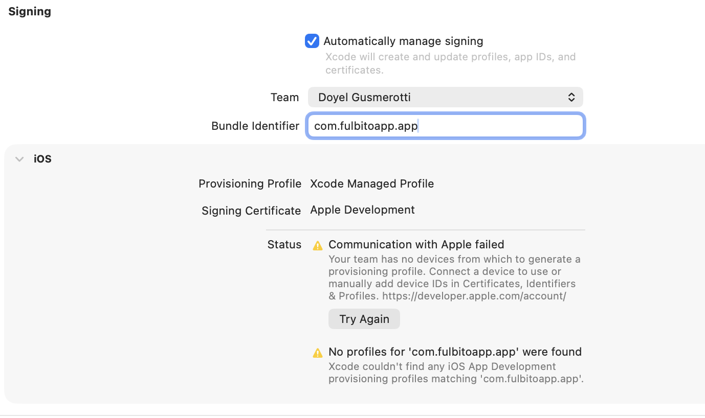

# iOS: Xcode Configuration

> Back to the [Apple overview](./apple.md).

## You do not need to change anything in Xcode

At the moment, **you do not have to modify any setting manually in Xcode**. The `ios` folder is generated after running the command `npx expo prebuild --platform ios --clean` (see [Regenerate the native project](#regenerate-the-native-project)), and every value is defined in code, so it is created correctly each time:

| What                                                                | Where it is defined                                        |
| ------------------------------------------------------------------- | ---------------------------------------------------------- |
| Bundle ID, version, build number, Team ID, entitlements, Info.plist | `app.json` (`ios.bundleIdentifier`, `ios.buildNumber`, `ios.appleTeamId`, `ios.entitlements`, `ios.infoPlist`) |
| Firebase file                                                       | `app.json` (`ios.googleServicesFile`)                      |
| Extra native changes made during prebuild (Podfile and Xcode project) | `plugins/with-nse-dynamic-frameworks.js`                 |

The plugin `plugins/with-nse-dynamic-frameworks.js` runs automatically every time you run `expo prebuild`. It is needed by the notification service extension (`NotifyKitNSE`) used for push notifications, and it does two things:

- **Edits the `Podfile`:** adds `use_frameworks! :linkage => :dynamic` to the `NotifyKitNSE` target and the `$NotifeeExtension = true` flag.
- **Edits the Xcode project:** sets the `DEVELOPMENT_TEAM` of the `NotifyKitNSE` target using `ios.appleTeamId` from `app.json`.

> **Important:** Do not edit the `Podfile` or the Xcode project by hand. The `ios` folder is regenerated with `--clean`, so manual changes are lost. If you need another native change, make it in `app.json` or add it to a config plugin in `plugins/`.

You only need to open Xcode to **create the archive** (see [Archive and TestFlight](./ios-archive-and-testflight.md)), or to check the signing values described below.

## Regenerate the native project

Run this command whenever you change `app.json` (for example the version or build number), a plugin, or the app icon and splash screen:

```bash
npx expo prebuild --platform ios --clean
```

> **Note:** The `--clean` flag regenerates the native iOS project. Make sure any required native changes are already reflected in your Expo configuration or plugins before running this command.

## 1. Open the iOS Project (only to check or archive)

Open the project's `ios` directory in Xcode.

In the Project Navigator on the left side of Xcode, select the application target, in this case **Mobile**.

The project configuration will then be displayed on the right side of Xcode.

---

## 2. Check Signing & Capabilities

These values come from `app.json`, so normally they are already correct and you only need to **verify** them. Change them in `app.json` and run prebuild again, not in Xcode.

Select:

**Signing & Capabilities**

Make sure that the **Bundle Identifier** matches the App ID previously registered in the Apple Developer account.



Verify the following configuration:

- **Team:** The appropriate Apple Developer team.
- **Bundle Identifier:** The Bundle ID registered in Apple Developer.
- **Automatically manage signing:** Enabled, unless the project requires manual signing configuration.

Xcode should then be able to generate and manage the appropriate provisioning configuration.

> **Note:** If no development device has been registered, Xcode may display a signing or provisioning error. In that case, a TestFlight build cannot be created until the required development device and signing configuration are available.
