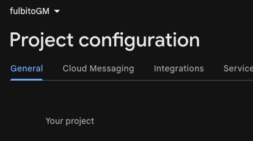
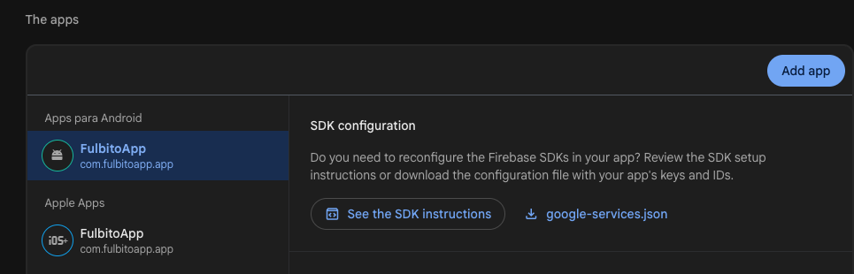
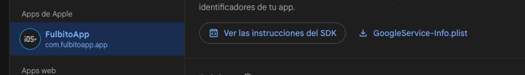
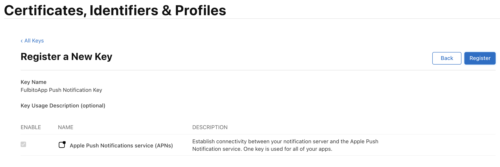
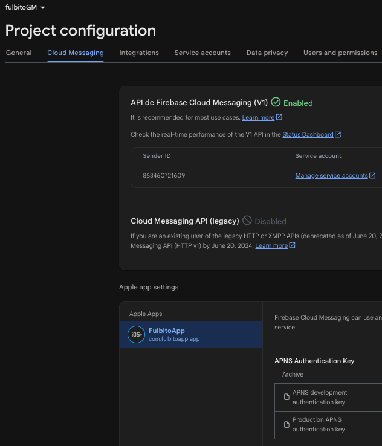
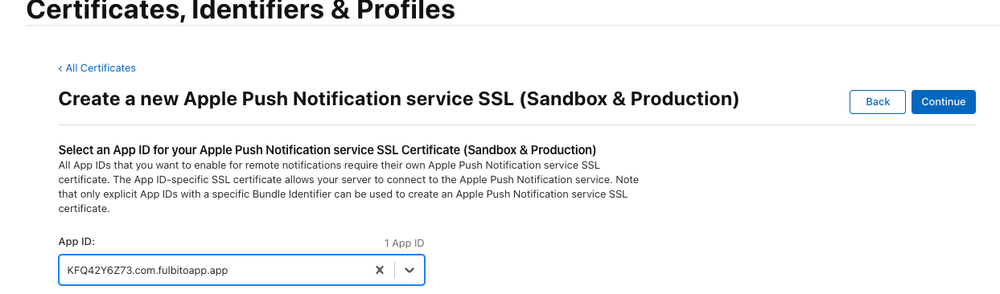
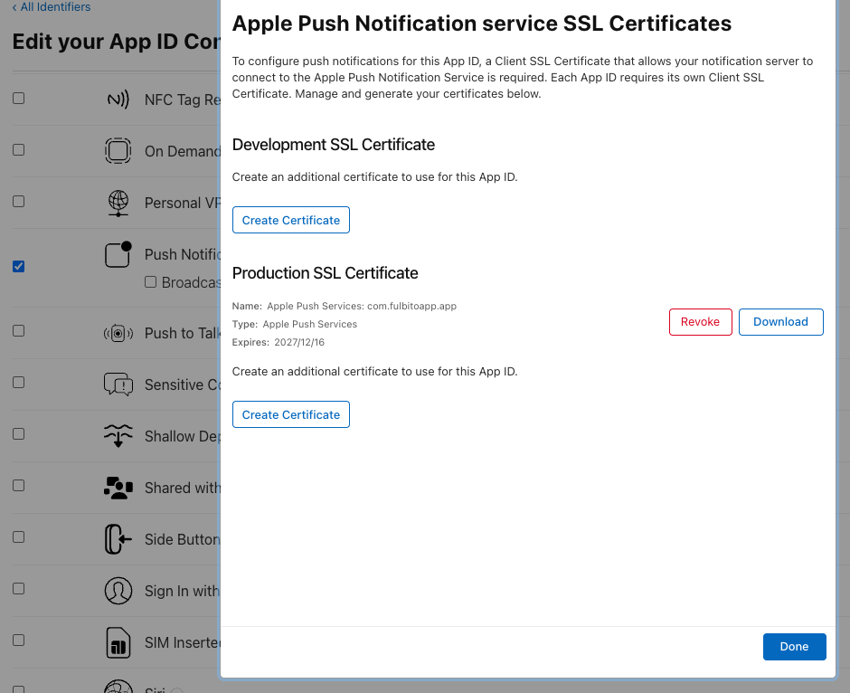
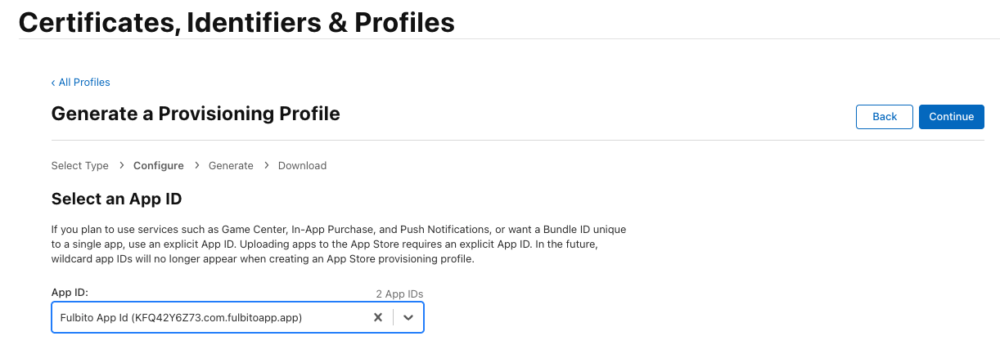

# Push Notifications Setup

> **Document preview:** To preview this Markdown document in Visual Studio Code, press `Ctrl + Shift + V`.
>
> Back to the [publication overview](../README.md).

This guide explains, step by step, how to configure push notifications for FulbitoApp on **Android** and **iOS**.

## How it works (the short version)

Your app never talks directly to the phone. The flow is:

```
Our backend / Firebase  →  Firebase Cloud Messaging (FCM)  →  Google (Android) or Apple APNs (iOS)  →  The phone
```

- **Firebase Cloud Messaging (FCM)** is the service that sends the notifications.
- **APNs** (Apple Push Notification service) is Apple's own delivery service. Firebase needs permission to use it, and that permission is an **APNs Authentication Key (.p8)** that you create in your Apple Developer account.
- Android needs only one file from Firebase. iOS needs files from Firebase **and** several things configured in Apple Developer.

## Before you start

Make sure you have:

| Requirement                                  | Where to get it                                                         |
| -------------------------------------------- | ----------------------------------------------------------------------- |
| Access to the **fulbitoGM** Firebase project | Ask the project owner to add you in Firebase → Project settings → Users |
| A paid **Apple Developer Program** account   | See [apple.md](./apple.md)                                              |
| Admin or App Manager role in Apple Developer | Ask the account holder                                                  |
| A **real iPhone** (for testing iOS)          | The iOS simulator cannot receive remote push notifications              |

App identifiers used in this project (they must match everywhere, down to the last letter):

| Platform | Identifier           |
| -------- | -------------------- |
| Android  | `com.fulbitoapp.app` |
| iOS      | `com.fulbitoapp.app` |

> **Tip:** if a notification does not arrive, 90% of the time an identifier does not match somewhere. Check this table first.

## 1. Open the Firebase project settings

1. Go to the [Firebase console](https://console.firebase.google.com/).
2. Open the **fulbitoGM** project.
3. Click the **gear icon** next to _Project Overview_ and choose **Project settings**.



## 2. Android setup

1. In **Project settings → General**, scroll to **Your apps**.
2. Click **Add app** and choose the **Android** icon.
3. In **Android package name**, type `com.fulbitoapp.app`.
4. Follow the wizard and click **Download google-services.json**.
5. Save the file as `apps/mobile/google-services.json`.



The file is already referenced in `app.json`:

```json
"android": {
  "package": "com.fulbitoapp.app",
  "googleServicesFile": "./google-services.json"
}
```

> **Do not commit** `google-services.json` or `GoogleService-Info.plist` unless the team has agreed to it. Check with `git status` before committing.

Android is done. Nothing else is required in Firebase for Android.

## 3. iOS setup

iOS has more steps because Apple requires you to prove that Firebase is allowed to send notifications to your app. Do the steps in order.

### 3.1 Add the iOS app in Firebase

1. In **Project settings → General → Your apps**, click **Add app** and choose the **iOS** icon.
2. In **Apple bundle ID**, type `com.fulbitoapp.app`.
3. Click **Download GoogleService-Info.plist**.
4. Save the file as `apps/mobile/GoogleService-Info.plist`.



This file is already referenced in `app.json`:

```json
"ios": {
  "bundleIdentifier": "com.fulbitoapp.app",
  "googleServicesFile": "./GoogleService-Info.plist"
}
```

### 3.2 Create the APNs Authentication Key (.p8)

This is the most important iOS step. The `.p8` key lets Firebase send notifications through Apple.

1. Go to [Apple Developer → Certificates, Identifiers & Profiles → Keys](https://developer.apple.com/account/resources/authkeys/list).
2. Click the **+** button to register a new key.
3. Write a **Key Name**, for example `FulbitoApp Push Notification Key`.
4. Check **Apple Push Notifications service (APNs)**.
5. Click **Continue**, then **Register**.



6. Click **Download** and save the `.p8` file somewhere safe.

> **Warning:** Apple lets you download the `.p8` file **only once**. If you lose it, you must revoke the key and create a new one. Also write down the **Key ID** shown on the page, you will need it in the next step.

> **Never commit the `.p8` file** to the repository. Store it in the team password manager or a shared secure drive.

### 3.3 Upload the key to Firebase

1. In Firebase, go to **Project settings → Cloud Messaging** tab.
2. Scroll to **Apple app settings** and select the **FulbitoApp** (`com.fulbitoapp.app`) app.
3. Under **APNs Authentication Key**, click **Upload**.
4. Select the `.p8` file and type the **Key ID** (from Apple) and your **Team ID** (the 10-character code shown at the top right of the Apple Developer page, in this project `KFQ42Y6Z73`).
5. Click **Upload**. You can upload one key for development and one for production, or use the same key for both.



> Without this step **iOS notifications will never arrive**, even if everything else is correct.

### 3.4 Enable Push Notifications on the App ID

Your App ID in Apple Developer must have the Push Notifications capability turned on.

1. Go to [Identifiers](https://developer.apple.com/account/resources/identifiers/list).
2. Click the identifier **Fulbito App Id** (`com.fulbitoapp.app`).
3. In the **Capabilities** list, check **Push Notifications**.
4. Click **Save** (top right).

### 3.5 Create the Push SSL certificates (Development and Production)

> **Is this needed?** Firebase only needs the `.p8` key from step 3.2. The SSL certificates below are what Apple calls the _legacy_ way, and some Apple flows (and providers other than Firebase) still ask for them. We keep them created so the App ID is fully configured and ready for both environments.

**Step A: create a Certificate Signing Request (CSR) on your Mac**

1. Open **Keychain Access** (press `Cmd + Space` and type _Keychain Access_).
2. In the top menu choose **Keychain Access → Certificate Assistant → Request a Certificate From a Certificate Authority...**
3. Fill in:
   - **User Email Address**: your email
   - **Common Name**: any name, for example `FulbitoApp Push`
   - **CA Email Address**: leave empty
4. Select **Saved to disk** and click **Continue**.
5. Save the `.certSigningRequest` file.

**Step B: create the certificate in Apple Developer**

1. Go to [Certificates](https://developer.apple.com/account/resources/certificates/list) and click **+**.
2. Under **Services**, choose **Apple Push Notification service SSL (Sandbox & Production)** and click **Continue**.
3. Select the App ID `com.fulbitoapp.app` and click **Continue**.



4. Upload the `.certSigningRequest` file from Step A and click **Continue**.
5. Click **Download** to get the `.cer` file. Double-click it to install it in Keychain Access.

**Step C: check the certificate on the App ID**

1. Go back to [Identifiers](https://developer.apple.com/account/resources/identifiers/list) and open **Fulbito App Id**.
2. Next to **Push Notifications**, click **Configure**.
3. You should see the certificate listed under **Development SSL Certificate** and/or **Production SSL Certificate**, with its expiration date.



> **Certificates expire** (the one in the screenshot expires on 2027/12/16). Add a reminder in the team calendar to renew it before that date. Use **Revoke** only if you are sure it is no longer used.

If you ever need a `.p12` file (some providers ask for it): in Keychain Access, open **My Certificates**, right click the certificate, choose **Export...**, select the `.p12` format and set a password.

### 3.6 Create a Provisioning Profile

A provisioning profile links your app, your Apple team and your devices/distribution method. It must be created **after** Push Notifications is enabled on the App ID (step 3.4), otherwise the profile will not include push support.

1. Go to [Profiles](https://developer.apple.com/account/resources/profiles/list) and click **+**.
2. Choose the type:
   - **iOS App Development** to test on your own iPhone
   - **App Store Connect** to publish to TestFlight / App Store
3. Select the App ID **Fulbito App Id** (`com.fulbitoapp.app`) and click **Continue**.



4. Select the certificate(s) to include and click **Continue**.
5. For a development profile, select the test devices. Then click **Continue**.
6. Give it a name, for example `FulbitoApp Development`, and click **Generate**.
7. Click **Download**.

> If you build with **EAS** (`eas build`), EAS can create and manage profiles and certificates for you. Use the manual profile only if you sign locally in Xcode.

## 4. Check the app configuration

These values already exist in `apps/mobile/app.json`. Verify them if something fails:

| Setting                            | Expected value                                                                              | Why                                               |
| ---------------------------------- | ------------------------------------------------------------------------------------------- | ------------------------------------------------- |
| `ios.bundleIdentifier`             | `com.fulbitoapp.app`                                                                        | Must match Firebase and Apple                     |
| `ios.entitlements.aps-environment` | `development` (local) / `production` (store)                                                | Tells Apple which push environment the build uses |
| `ios.infoPlist.UIBackgroundModes`  | `["remote-notification"]`                                                                   | Lets iOS wake the app when a notification arrives |
| `android.package`                  | `com.fulbitoapp.app`                                                                        | Must match Firebase                               |
| Plugins                            | `@react-native-firebase/app`, `@react-native-firebase/messaging`, `react-native-notify-kit` | Firebase + notification handling                  |

After changing any native setting (`app.json`, plugins, `google-services.json`, `GoogleService-Info.plist`), you must **rebuild** the native app:

```bash
cd apps/mobile
pnpm expo prebuild --clean
pnpm expo run:ios      # or run:android
```

## 5. Test a notification

> **Important:** push notifications on iOS only work on a **real device**. The iOS simulator does not receive them. Android works on both emulators (with Google Play services) and real devices.

1. Build and install the app on your device and open it once.
2. Accept the notification permission prompt.
3. In Firebase, go to **Engage → Messaging → Create your first campaign → Firebase Notification messages**.
4. Write a title and text and click **Send test message**.
5. Paste the device's **FCM registration token** and click **Test**.

The notification should appear within a few seconds. Try it with the app open, in the background and fully closed.

## Troubleshooting

| Problem                                     | Likely cause and fix                                                                                        |
| ------------------------------------------- | ----------------------------------------------------------------------------------------------------------- |
| Nothing arrives on iOS                      | The `.p8` key was not uploaded to Firebase (step 3.3), or Key ID / Team ID are wrong                        |
| Nothing arrives on iOS simulator            | Expected. Use a real device                                                                                 |
| Works in development, fails in TestFlight   | Build uses the wrong `aps-environment`, or only a development APNs key is uploaded. Upload a production key |
| Provisioning profile has no push capability | Create it again after enabling Push Notifications on the App ID                                             |
| `google-services.json` / plist not found    | Files are not in `apps/mobile/` or the names in `app.json` do not match                                     |
| Notification permission never asked         | Uninstall the app and install it again, or enable notifications in the phone Settings                       |
| Changes in `app.json` have no effect        | Rebuild native code (`expo prebuild --clean`), a JS reload is not enough                                    |

## Useful links

- [Firebase: Set up an iOS client app with FCM](https://firebase.google.com/docs/cloud-messaging/ios/client)
- [Firebase: Set up an Android client app with FCM](https://firebase.google.com/docs/cloud-messaging/android/client)
- [Apple: Establishing a token-based connection to APNs](https://developer.apple.com/documentation/usernotifications/establishing-a-token-based-connection-to-apns)
- [Alibaba Cloud Guide: Create an iOS push certificate](https://www.alibabacloud.com/help/en/mobile-platform-as-a-service/latest/create-an-ios-push-certificate)
