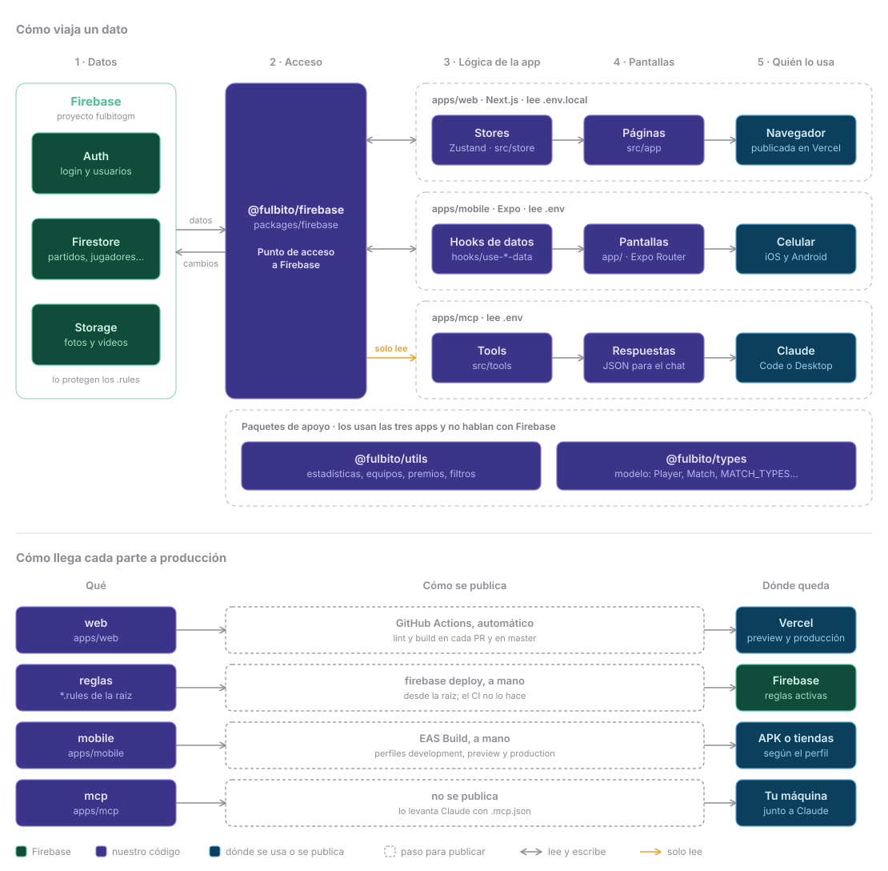

# Documentación de Fulbito GM

Fulbito GM es una aplicación para la gestión de partidos de fútbol dentro de una organización. Permite crear y organizar partidos, armar los equipos mediante un algoritmo de autocompletado equilibrado, conservar el historial de resultados y obtener estadísticas y premios a partir de esa información. Los datos se organizan por torneo: cada usuario ve y gestiona solo los torneos de los que es miembro. Está disponible como aplicación web, aplicación móvil y servidor MCP.

## Componentes principales

| Área                                      | Código                                                  |
| ----------------------------------------- | ------------------------------------------------------- |
| [Web](./web/README.md)                    | `apps/web`                                              |
| [Mobile](./mobile/README.md)              | `apps/mobile`                                           |
| [MCP](./mcp/README.md)                    | `apps/mcp`                                              |
| [Functions](./functions/README.md)        | `apps/functions`                                        |
| [Firebase (backend)](#datos-en-firestore) | `packages/firebase`, `firestore.rules`, `storage.rules` |

## Panorama general

Monorepo con **pnpm** y **turbo**. Hay tres apps y no hay servidor propio: todas hablan con Firebase a través de los mismos paquetes.



Tiene dos partes. Arriba, **cómo viaja un dato**, de izquierda a derecha:

1. **Datos.** Viven en Firebase: Auth (usuarios), Firestore (colecciones) y Storage (fotos y videos).
2. **Acceso.** `@fulbito/firebase` es el punto de acceso a Firebase. Las apps solo usan el SDK directamente para inicializarlo (`lib/firebase.ts`), con una excepción: `apps/web/src/store/useVideoClipStore.ts`.
3. **Lógica de la app.** Cada app guarda los datos a su manera: stores de Zustand en web, hooks en mobile y tools en el MCP.
4. **Pantallas.** Lo que se muestra: páginas en web, pantallas en mobile y respuestas en el MCP.
5. **Quién lo usa.** El navegador, el celular o Claude.

Abajo, **cómo llega cada parte a producción**: qué es, cómo se publica y dónde queda. Solo la web se publica sola; el resto es a mano o no se publica.

### Ubicación de cada parte del código

| Para modificar…                             | Ubicación                                      |
| ------------------------------------------- | ---------------------------------------------- |
| Una pantalla de la web                      | `apps/web/src/app` y `apps/web/src/components` |
| Una pantalla de mobile                      | `apps/mobile/app` y `apps/mobile/components`   |
| Un cálculo (estadísticas, equipos, premios) | `packages/utils`                               |
| Un campo o un tipo del modelo               | `packages/types`                               |
| El acceso a los datos de Firebase           | `packages/firebase`                            |
| Quién puede leer o escribir cada dato       | `firestore.rules` y `storage.rules`            |
| Una herramienta para Claude                 | `apps/mcp/src/tools`                           |
| Una notificación push del servidor          | `apps/functions/src`                           |
| El CI o el despliegue                       | `.github/workflows/main.yml`                   |

### Paquetes compartidos

| Paquete                  | Qué tiene                                             |
| ------------------------ | ----------------------------------------------------- |
| `@fulbito/types`         | Modelo de dominio: tipos y constantes (`MATCH_TYPES`) |
| `@fulbito/utils`         | Lógica pura: equipos, estadísticas, premios, fechas   |
| `@fulbito/firebase`      | Acceso a Firebase (Auth, Firestore, Storage)          |
| `@fulbito/eslint-config` | Reglas de lint compartidas                            |

Lo que usan dos apps va en `packages/`. `utils` no importa frameworks, así que funciona igual en web, mobile y MCP.

### Datos en Firestore

Colecciones que protegen las reglas de `firestore.rules`. Los datos del juego llevan un `tournamentId`, y el acceso depende del rol del usuario en ese torneo: `OWNER` (quien lo creó), `ADMIN` o `MEMBER`. El rol global `ADMIN` de `users` funciona como superadministrador.

| Colección                                         | Quién lee                   | Quién escribe                                                 |
| ------------------------------------------------- | --------------------------- | ------------------------------------------------------------- |
| `players`, `matches`, `matchPlayers`, `addresses` | Miembros del torneo         | Owner y admins del torneo                                     |
| `videoClips`                                      | Miembros del torneo         | Cualquier miembro sube; edita o borra su autor o un admin     |
| `tournaments`                                     | Sus miembros                | Lo crea su owner; lo editan owner y admins                    |
| `tournaments/{id}/members`                        | Miembros del torneo         | Se crean al aceptar una invitación; el owner cambia roles     |
| `tournaments/{id}/playerRequests`                 | Quien la pidió y los admins | Un miembro pide vincularse a un jugador; resuelven los admins |
| `tournaments/{id}/comments`                       | Miembros del torneo         | Cualquier miembro; borran los admins                          |
| `invitations`                                     | El invitado y los admins    | Owner y admins del torneo; el invitado acepta o rechaza       |
| `users`                                           | Cada usuario su documento   | Cada usuario, salvo `role` y `linkedPlayerId`                 |

Storage guarda, por torneo, fotos de jugadores (`players/{torneo}/`), clips de video (`videoClips/{torneo}/`, hasta 200 MB) y el logo del torneo (`tournaments/{torneo}/`).

## Levantar el proyecto

Requisitos: Node según `.nvmrc` (22.23.4 o más nuevo), **pnpm** (la versión está en `packageManager`) y, para iOS, Xcode con el simulador.

```bash
nvm use
pnpm install    # siempre desde la raíz y siempre con pnpm: los paquetes internos usan workspace:*
```

| App    | Comando                                     | Dónde corre           |
| ------ | ------------------------------------------- | --------------------- |
| Web    | `pnpm --filter @fulbito/web dev`            | http://localhost:3000 |
| Mobile | `pnpm --filter @fulbito/mobile ios`         | Simulador de iOS      |
| MCP    | `pnpm --silent --filter @fulbito/mcp start` | stdio, lo abre Claude |

- Primero hacen falta los `.env` (sección siguiente).
- Para trabajar sin tocar los datos reales: `pnpm emulators` levanta los emuladores de Auth, Firestore y Storage (requiere Java) con dos cuentas de prueba, `test@test.com` y `test2@test.com` (contraseña `123456`), y un torneo con jugadores. Está listo cuando imprime `✔ Test accounts ready`. Las apps se conectan a él con las variables `*_USE_FIREBASE_EMULATOR`.
- `.mcp.json` registra el servidor MCP como `fulbito`, así que Claude Code lo levanta solo desde la raíz.
- Mobile también tiene `start`, `android` y `web`. Con `ios` se compila la app nativa y no se usa Expo Go.

## Variables de entorno

Cada app carga la configuración del cliente de Firebase desde su propio `.env`, excluido del repositorio por `.gitignore` (salvo los `.env.example`). Los valores son los mismos en las tres apps (Firebase Console → Project settings → Your apps); solo cambia el prefijo. En web y mobile las seis variables son obligatorias: Auth necesita `AUTH_DOMAIN`, Firestore `PROJECT_ID` y Storage `STORAGE_BUCKET`. El código solo comprueba la API key: `initFirebase` (`@fulbito/firebase`) no inicializa Firebase si falta y no emite ningún error; las demás, si faltan, fallan recién al usarse.

### Web

`apps/web/.env.local` · leído en `apps/web/src/lib/firebase.ts` · sin plantilla

```bash
NEXT_PUBLIC_FIREBASE_API_KEY=
NEXT_PUBLIC_FIREBASE_AUTH_DOMAIN=
NEXT_PUBLIC_FIREBASE_PROJECT_ID=
NEXT_PUBLIC_FIREBASE_STORAGE_BUCKET=
NEXT_PUBLIC_FIREBASE_MESSAGING_SENDER_ID=
NEXT_PUBLIC_FIREBASE_APP_ID=
NEXT_PUBLIC_USE_FIREBASE_EMULATOR=         # opcional: true conecta con los emuladores locales
```

### Mobile

`apps/mobile/.env` · leído en `apps/mobile/lib/firebase.ts` · plantilla en `apps/mobile/.env.example`

```bash
EXPO_PUBLIC_FIREBASE_API_KEY=
EXPO_PUBLIC_FIREBASE_AUTH_DOMAIN=
EXPO_PUBLIC_FIREBASE_PROJECT_ID=
EXPO_PUBLIC_FIREBASE_STORAGE_BUCKET=
EXPO_PUBLIC_FIREBASE_MESSAGING_SENDER_ID=
EXPO_PUBLIC_FIREBASE_APP_ID=
EXPO_PUBLIC_USE_FIREBASE_EMULATOR=         # opcional: true conecta con los emuladores locales
EXPO_PUBLIC_FIREBASE_EMULATOR_HOST=        # opcional: 127.0.0.1 en el simulador de iOS, la IP de la red en un dispositivo
```

Con el emulador activado y sin `EMULATOR_HOST`, se usa `127.0.0.1` en iOS y `10.0.2.2` en Android. La plantilla incluye además `EXPO_PUBLIC_DEV_IS_ADMIN=false`, que ningún archivo lee.

### MCP

`apps/mcp/.env` · leído en `apps/mcp/src/firebase.ts` · plantilla en `apps/mcp/.env.example`

```bash
FIREBASE_API_KEY=                          # requerida
FIREBASE_AUTH_DOMAIN=
FIREBASE_PROJECT_ID=                       # requerida
FIREBASE_STORAGE_BUCKET=
FIREBASE_MESSAGING_SENDER_ID=
FIREBASE_APP_ID=
FIREBASE_MCP_EMAIL=                        # requerida: cuenta con la que el MCP inicia sesión
FIREBASE_MCP_PASSWORD=                     # requerida
```

El MCP inicia sesión con esa cuenta y solo ve los torneos de los que es miembro; cada herramienta recibe el `tournamentId`. Si falta alguna variable requerida, responde `Firebase config missing`, y si la cuenta no puede iniciar sesión, `Could not sign in with FIREBASE_MCP_EMAIL / FIREBASE_MCP_PASSWORD`. El archivo se busca en el directorio de trabajo. Con `pnpm --filter @fulbito/mcp start` (y con `.mcp.json`) ese directorio es `apps/mcp`. Las variables también pueden llegar por el entorno del proceso, como en la configuración de Claude Desktop.

### Scripts de mantenimiento (`apps/web/scripts/`)

Scripts de Node que operan directamente sobre el proyecto de Firebase configurado en `apps/web/.env.local`. No forman parte del uso diario. Se ejecutan desde `apps/web` y las credenciales se pasan como variables en la línea de comandos.

```bash
# Carga inicial de jugadores: borra la colección players y la vuelve a crear
SEED_EMAIL= SEED_PASSWORD= node scripts/seed-firebase.mjs

# Elimina campos obsoletos de players; sin --apply solo muestra los cambios
node scripts/cleanup-orphan-player-fields.mjs
SEED_EMAIL= SEED_PASSWORD= node scripts/cleanup-orphan-player-fields.mjs --apply

# Migración histórica desde Neon (PostgreSQL)
NEON_DATABASE_URL= SEED_EMAIL= SEED_PASSWORD= node scripts/migrate-neon-to-firebase.mjs
```

- `SEED_EMAIL` y `SEED_PASSWORD` son las credenciales de una cuenta de la app. `cleanup-orphan-player-fields --apply` exige que tenga rol `ADMIN`, y `seed-firebase` también lo necesita en la práctica, porque `firestore.rules` solo permite borrar jugadores a un admin.
- `migrate-neon-to-firebase` no arranca sin las tres variables.
- **Todos menos el dry run de `cleanup` escriben en la base real.**
- Son anteriores a los torneos: escriben documentos sin `tournamentId`, que las reglas actuales no aceptan (a verificar antes de usarlos).

En la raíz, `scripts/migrate-to-tournament.mjs` mueve los datos que no tienen `tournamentId` a un torneo (`--name`, `--owner`, `--admin`); sin `--apply` solo muestra los cambios y con `--emulator` trabaja sobre el emulador.

### CI y Vercel

Secrets del repositorio, usados por `.github/workflows/main.yml` para el deploy:

```bash
VERCEL_TOKEN=
VERCEL_ORG_ID=
VERCEL_FRONTEND_PROJECT_ID=   # el workflow lo expone como VERCEL_PROJECT_ID
```

Las seis `NEXT_PUBLIC_FIREBASE_*` se configuran en el proyecto de Vercel para los builds de preview y producción (a verificar en Vercel). `turbo.json` las declara en la tarea `build`.

### Notas

- Los prefijos `NEXT_PUBLIC_` y `EXPO_PUBLIC_` exponen el valor en el cliente. Es esperado: la configuración del cliente de Firebase no es secreta y el acceso lo controlan `firestore.rules` y `storage.rules`.
- Las variables se leen al arrancar: después de cambiar un `.env` hay que reiniciar el servidor de desarrollo.

## Flujo de trabajo

### Commits

- En inglés, con [Conventional Commits](https://www.conventionalcommits.org) y el alcance de la app o el paquete: `feat(web)`, `fix(utils)`, `refactor(mobile)`.
- Atómicos: cada commit tiene sentido por sí solo y no rompe el build.
- El mensaje describe el cambio en lenguaje claro, no el mecanismo interno. Por ejemplo, `fix(utils): compute season lost finals from final matches only`.

### Pull requests

El **título** sigue Conventional Commits y describe el problema resuelto o el resultado desde la perspectiva de quien usa la app, no la implementación.

| Correcto                                                  | Incorrecto                           |
| --------------------------------------------------------- | ------------------------------------ |
| `fix: modal closing unexpectedly when clicking inside it` | `refactor: unify backdrop component` |
| `feat: filter statistics by match type, kind and year`    | `feat: add filterMatches to utils`   |

La **descripción** se organiza en estas secciones:

1. **Problem:** qué pasa hoy y por qué es un problema: el comportamiento actual, en qué pantalla o flujo ocurre y a quién afecta. En un error, cómo reproducirlo. Se puede omitir solo cuando el PR agrega algo nuevo sin corregir nada existente.
2. **Objective:** qué se busca y qué va a resolver, en una a tres líneas. Cierra con `Resolves #<issue>`.
3. **Features / Functionality:** los cambios concretos, con el archivo o la carpeta afectada y agrupados por plataforma (web, mobile).
4. **Evidence / Demos:** una captura o un video por cada pantalla o flujo afectado. Es obligatoria: al no haber tests automatizados, es la prueba de que el cambio funciona.

Antes de pedir revisión:

- `pnpm lint` y `pnpm build` pasan, y el cambio se probó a mano.
- El diff no incluye `console.log`, código comentado, archivos generados ni `.env`.

El CI (`.github/workflows/main.yml`) corre lint y build en cada PR y publica un preview en Vercel. Al mergear a `master`, la web se despliega a producción.

### Calidad de código

Las reglas están en `CLAUDE.md`: TypeScript estricto, sin `any`, sin comentarios (lo exige ESLint) y Prettier como formato. No hay tests automatizados.

## Glosario

| Término          | Significado                                                                    |
| ---------------- | ------------------------------------------------------------------------------ |
| Amistoso         | Partido que no cuenta para rachas ni campeonatos                               |
| Borrador / final | Partido sin resultado / partido jugado                                         |
| Camisetas        | Quien se las lleva a lavar; se reparte parejo                                  |
| Campeón          | Quien llega a 7 victorias seguidas                                             |
| Modo de partido  | Tamaño del partido, de `5v5` a `11v11`                                         |
| Torneo           | Espacio de una organización: sus jugadores, partidos y miembros                |
| Torneo activo    | El torneo que el usuario tiene elegido; todas las pantallas muestran sus datos |
