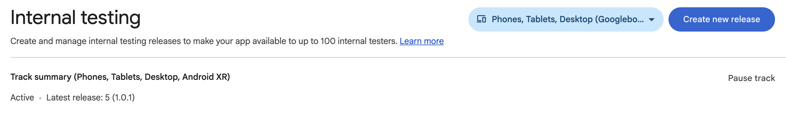
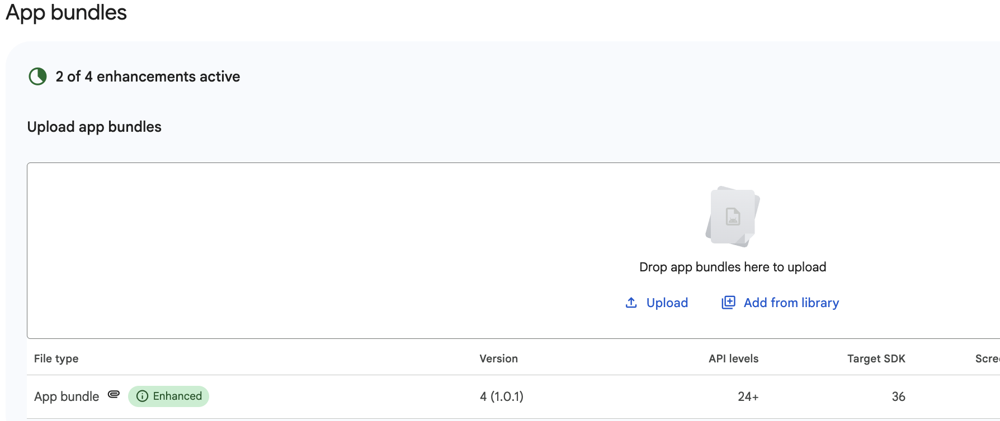
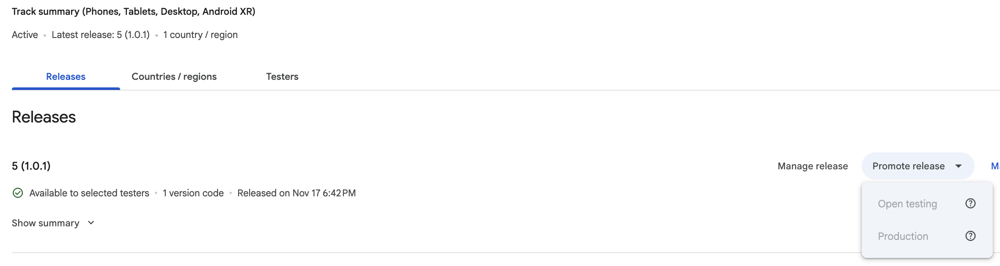

# Android: Upload the App Bundle (.aab) to Google Play

> **Document preview:** To preview this Markdown document in Visual Studio Code, press `Ctrl + Shift + V`.
>
> Back to the [Android overview](./google.md).

This guide explains how to upload the signed `.aab` file to the Google Play Console and publish it to the **Internal testing** track, so testers can install it before it goes to production.

## Before you start

- You have a signed `.aab` file. If not, follow [Generate a signed build](./android-signed-build.md). The file is at `android/app/build/outputs/bundle/release/app-release.aab`.
- `android.versionCode` in `app.json` is **higher than the one of the previous upload**. Google Play rejects a `versionCode` that was already used.
- You have access to the [Google Play Console](https://play.google.com/console) with permission to manage releases.

## 1. Open the Internal testing track

1. In the Google Play Console, select the **FulbitoApp** application.
2. In the left menu go to **Test and release → Testing → Internal testing**.
3. Click **Create new release** (top right).

The page shows the **Track summary**. In the screenshot, the latest release is `5 (1.0.1)`: `5` is the `versionCode` and `1.0.1` is the app `version`.

> **Why Internal testing first?** It is the fastest track (up to 100 testers) and normally does not need a full Google review, so it is the safest place to check a build before sending it to more people.

## 2. Upload the .aab file

In the **App bundles** section, click **Upload** and select `app-release.aab`. You can also drag and drop the file into the box.

When the upload finishes, the file appears in the table with its **Version** (`versionCode` and `version`), the **API levels** and the **Target SDK**. Check that the version is the one you expect.

> **If the upload is rejected:**
>
> - _"Version code X has already been used"_: increase `android.versionCode` in `app.json`, run the build again and upload the new file.
> - _Signing key errors_: the bundle was signed with a different keystore than the one used before. Use the project keystore (see [Create the signing keystore](./android-keystore.md)).

## 3. Write the release details

1. In **Release name**, keep the suggested name (it uses the version) or write your own.
2. In **Release notes**, write what changed for the testers, for example: `Push notifications and bug fixes`.
3. Click **Next**.

## 4. Review and start the rollout

1. Google shows a summary with errors or warnings. Errors must be fixed before continuing. Warnings can be reviewed and usually do not block the release.
2. Click **Save** and then **Go to overview** (or **Start rollout to Internal testing**) and confirm.

After a few minutes the release status is **Available to selected testers**.

## 5. Add the testers

1. In the same track, open the **Testers** tab.
2. Create an email list (or select an existing one) with the Google accounts of your testers.
3. Save, then copy the **Join on the web** link and send it to the testers. They must open it with the same Google account and accept the invitation, then install the app from the Play Store.

## 6. Promote the release

When the build is tested and approved, go to the **Releases** tab of the track. Next to the release, click **Promote release** and choose where to send it.

| Option           | Use it for                                        |
| ---------------- | ------------------------------------------------- |
| **Open testing** | Letting anyone with the link join the test        |
| **Production**   | Publishing to all users in the selected countries |

> **Note:** If **Open testing** or **Production** appear disabled (greyed out, as in the screenshot), Google Play still needs something from you: usually the store listing, the app content declarations, the target countries or the review of the application. Open the **Dashboard** of the Play Console and complete the pending tasks, or wait for the review to finish.

After choosing **Production**, follow the wizard (release notes, countries, review) and click **Start rollout to Production**. Google reviews the release before it goes live, which can take from a few hours to a few days.

## Quick checklist

- [ ] `versionCode` increased and the `.aab` signed with the project keystore
- [ ] `.aab` uploaded to Internal testing and the version shown is correct
- [ ] Release notes written
- [ ] Testers added and the app installed from the Play Store
- [ ] Push notifications checked on a real device (see [Push notifications](./push-notifications.md))
- [ ] Release promoted to Production
