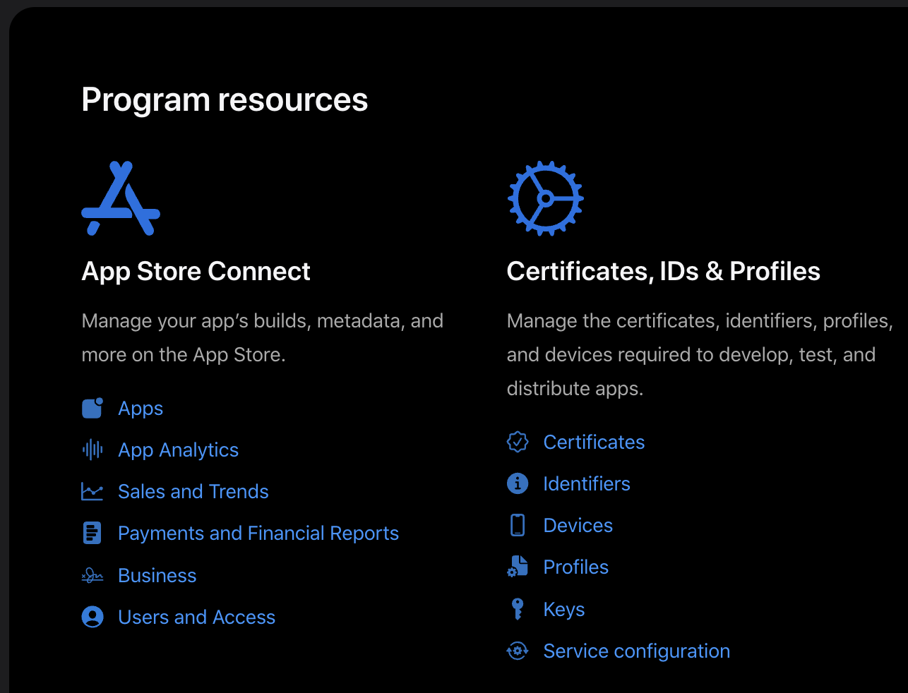
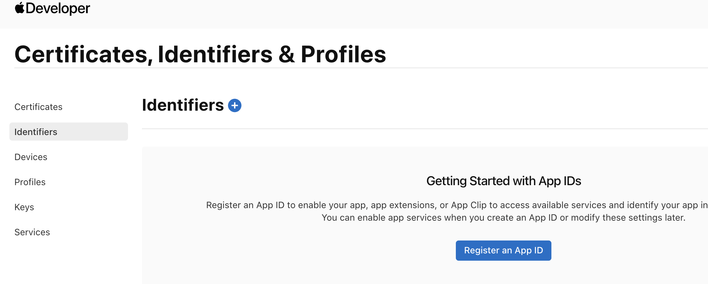
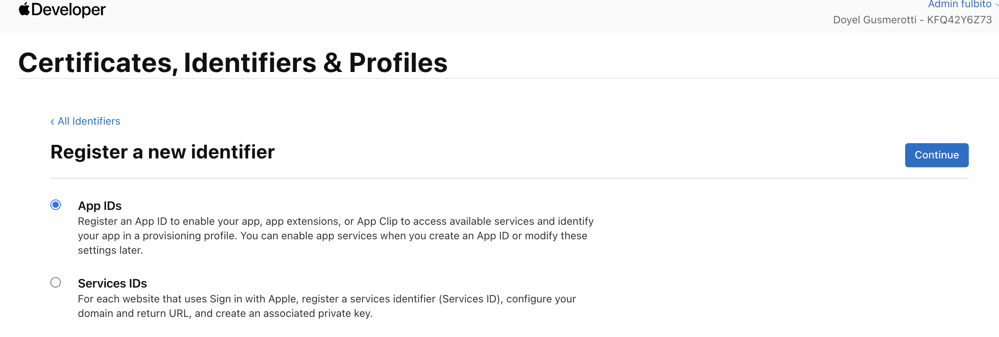
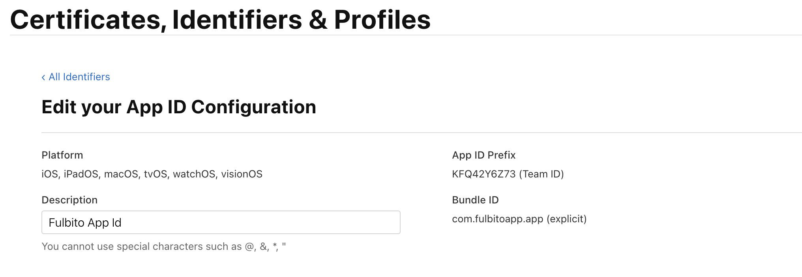
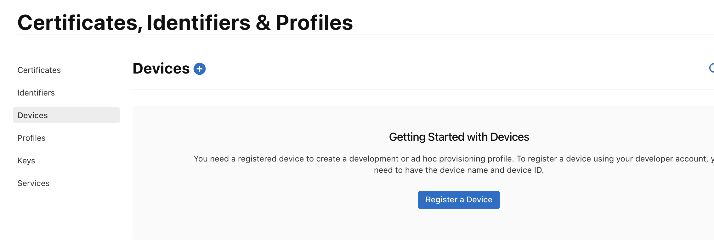
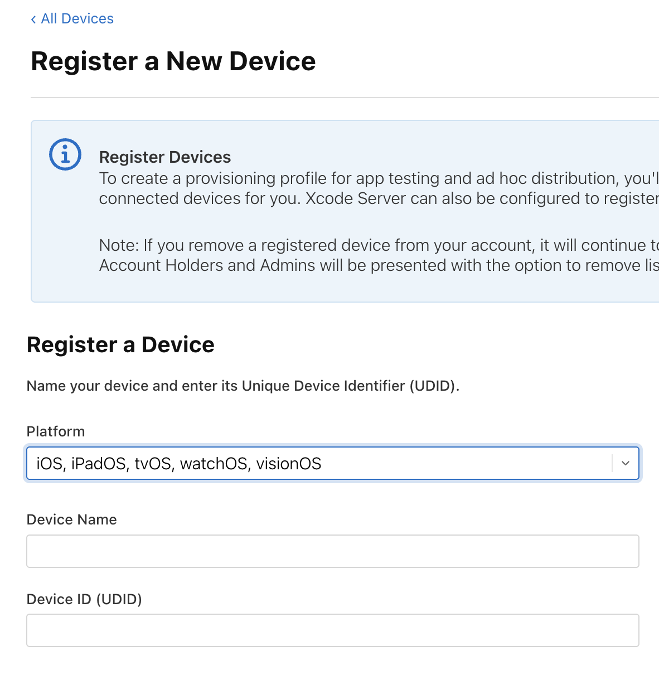

# iOS: Register the App ID and a Test Device

> Back to the [Apple overview](./apple.md).

This guide covers the two things you must create in the Apple Developer account before opening Xcode: the **App ID** of the application and at least one **test device**.

---

## 1. Apple Developer Account

### 1.1 Access the Apple Developer Account

Go to the [Apple Developer Account](https://developer.apple.com/account).

---

### 1.2 Register the App ID

Before configuring the application in Xcode, an **App ID** must be registered in the Apple Developer account.

Navigate to:

**Certificates, IDs & Profiles → Identifiers**

Click the **+** button to create a new identifier.

Select **App IDs** and continue.

Then, select **App** as the application type and click next.

Provide the following information:

- **Description:** A descriptive name for the application.
- **Bundle ID:** The unique Bundle Identifier used by the application.

The Bundle ID must be unique, we will use it as the "Bundle Identifier" field in Xcode.

After verifying the information, click **Register**.

---

## 2. Register a Development Device

At least one physical iOS device must be registered in the Apple Developer account for development and signing purposes.

For this project, an old **iPhone 6s** was registered as the development device.

### 2.1 Open the Devices Section

Navigate to:

**Certificates, IDs & Profiles → Devices**

Click the **+** button to register a new device.

---

### 2.2 Register the Device

Select the appropriate platform and enter the required device information.

The most important value is the device's **UDID (Unique Device Identifier)**.

The UDID can be obtained by connecting the iPhone to a Mac and checking the device information through Finder or Xcode.

Or in the device we can go to Configuration -> General -> information -> SEID.

> **Important:** The development device must be registered in the Apple Developer account before Xcode can use it for development signing.
