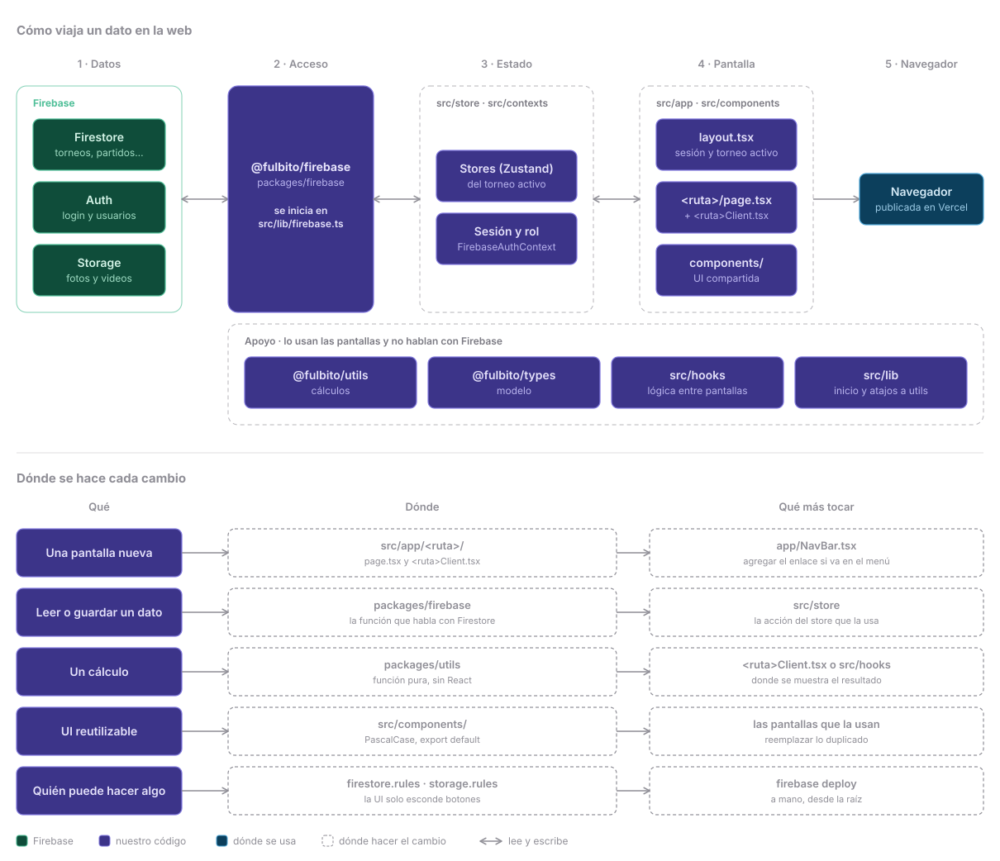

# Web

Vista general de la app web (`apps/web`): qué hay, cómo se levanta y dónde mirar.

## Estructura general

|           |                                                              |
| --------- | ------------------------------------------------------------ |
| Framework | Next.js 15 (App Router) y React 19                           |
| Estilos   | Tailwind CSS v4                                              |
| Estado    | Zustand 5                                                    |
| Backend   | Firebase: Auth, Firestore y Storage (no hay servidor propio) |
| Deploy    | GitHub Actions → Vercel                                      |

## Cómo está organizada



Arriba, el recorrido de un dato, de izquierda a derecha:

1. **Datos:** Firestore, Auth y Storage de Firebase.
2. **Acceso:** las lecturas y escrituras pasan por `@fulbito/firebase`, que se inicializa en `src/lib/firebase.ts` con las variables de `.env.local`. La excepción es `src/store/useVideoClipStore.ts`, que usa el SDK de Firebase directamente.
3. **Estado:** los stores de Zustand (`src/store/`, uno por colección) guardan los datos en memoria y exponen las acciones para modificarlos. La sesión y el rol del usuario viven en `FirebaseAuthContext`.
4. **Pantalla:** `layout.tsx` monta la barra de navegación, el proveedor de sesión y la carga inicial (`shared/AppBootstrap`). Cada ruta tiene un `page.tsx` que renderiza su `<ruta>Client.tsx`, el componente cliente que lee los stores y arma la vista con `src/components/`.
5. **Navegador:** la app publicada en Vercel.

Los cálculos vienen de `@fulbito/utils` y los tipos de `@fulbito/types`. `src/hooks/` agrupa lógica que comparten varias pantallas, y `src/lib/` contiene la inicialización de Firebase y atajos a `@fulbito/utils`.

Abajo, dónde se hace cada tipo de cambio y qué otra parte suele requerir ajuste. La única ruta que lee datos en el servidor es `/awards`: su `page.tsx` usa `getPlayersServer` y `getMatchesServer` y le pasa el resultado al cliente.

## Levantarla

```bash
nvm use                          # Node según .nvmrc
pnpm install                     # desde la raíz, siempre con pnpm
pnpm --filter @fulbito/web dev   # http://localhost:3000
```

Antes necesitás `apps/web/.env.local` (ver abajo). No hay tests: un cambio se comprueba con `pnpm --filter @fulbito/web lint`, `pnpm --filter @fulbito/web build`, `cd apps/web && pnpm exec tsc --noEmit` y probando a mano.

## Variables de entorno

Un único archivo, **`apps/web/.env.local`**, ignorado por git. Pedile los valores a alguien del equipo (no hay `.env.example`).

```bash
NEXT_PUBLIC_FIREBASE_API_KEY=...
NEXT_PUBLIC_FIREBASE_AUTH_DOMAIN=...
NEXT_PUBLIC_FIREBASE_PROJECT_ID=...
NEXT_PUBLIC_FIREBASE_STORAGE_BUCKET=...
NEXT_PUBLIC_FIREBASE_MESSAGING_SENDER_ID=...
NEXT_PUBLIC_FIREBASE_APP_ID=...
```

- Se leen solo en `apps/web/src/lib/firebase.ts`. Reiniciá `pnpm dev` al cambiarlas.
- `NEXT_PUBLIC_` las manda al navegador. No es un problema: la config web de Firebase no es secreta. Los datos los protegen `firestore.rules` y `storage.rules`.
- **Si falta la API key, la app no avisa:** falla después con errores de Firebase poco claros. Revisá este archivo primero.
- En producción van en el proyecto de Vercel. El CI usa además `VERCEL_TOKEN`, `VERCEL_ORG_ID` y `VERCEL_FRONTEND_PROJECT_ID`.
- `NEXT_PUBLIC_LOCATIONIQ_TOKEN` y `NEXT_PUBLIC_USE_FIREBASE_EMULATOR` son restos: nadie las lee.
- Los scripts de `apps/web/scripts/` usan este archivo más `SEED_EMAIL`, `SEED_PASSWORD` y `NEON_DATABASE_URL`, y **escriben datos reales**.

## Mapa de la app

Cada pantalla pide los datos a un store de Zustand, que los trae de Firebase a través de `@fulbito/firebase`. La lógica de cálculo viene de `@fulbito/utils`.

| Ruta                        | Para qué sirve                                                    | Quién puede                  |
| --------------------------- | ----------------------------------------------------------------- | ---------------------------- |
| `/`                         | Próximo partido, último resultado, campeonato                     | Todos                        |
| `/login`                    | Ingresar o registrarse                                            | Todos                        |
| `/players`, `/players/[id]` | Plantel y detalle de cada jugador                                 | Ver: todos. Editar: admin    |
| `/match`                    | Armar equipos y crear un partido                                  | Armar: todos. Guardar: admin |
| `/history`                  | Historial; cargar o editar resultados                             | Ver: todos. Editar: admin    |
| `/statistics`               | Estadísticas por jugador, filtrables por modo, tipo, año y estado | Todos                        |
| `/awards`                   | Premios y Salón de la Fama                                        | Todos                        |
| `/profile`                  | Mi cuenta y vincular mi jugador                                   | Logueados                    |
| `/notifications`            | Solicitudes de rol                                                | Admin                        |

Roles: `USER` (al registrarse), `PLAYER` (cuenta vinculada a un jugador) y `ADMIN`. Se piden en `/profile` y un admin los acepta en `/notifications`. **La UI solo esconde botones:** no hay middleware, y cualquier usuario logueado puede escribir partidos y canchas según las reglas de Firebase.

## Dónde está cada cosa

| Qué buscás                | Dónde                                                                      |
| ------------------------- | -------------------------------------------------------------------------- |
| Una pantalla              | `apps/web/src/app/<ruta>/` (casi siempre un `page.tsx` y un `*Client.tsx`) |
| Componentes reutilizables | `apps/web/src/components/`                                                 |
| Stores (datos)            | `apps/web/src/store/`, uno por colección                                   |
| Sesión y rol              | `apps/web/src/contexts/FirebaseAuthContext.tsx`                            |
| Colores y tema            | `apps/web/src/app/globals.css`                                             |

Cada store carga su colección con `initLoad()` y vuelve a traerla entera después de cada cambio. Los equipos de un partido están en la colección `matchPlayers`, no dentro de `matches`.


